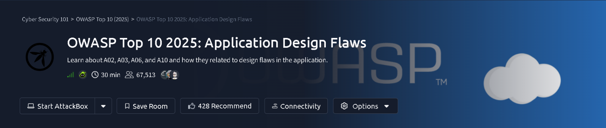
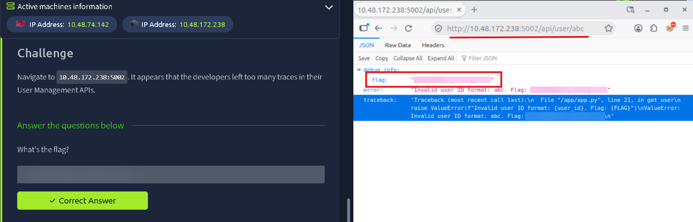
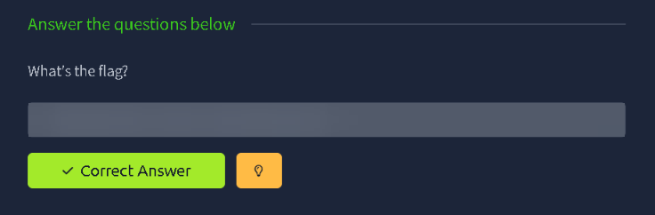
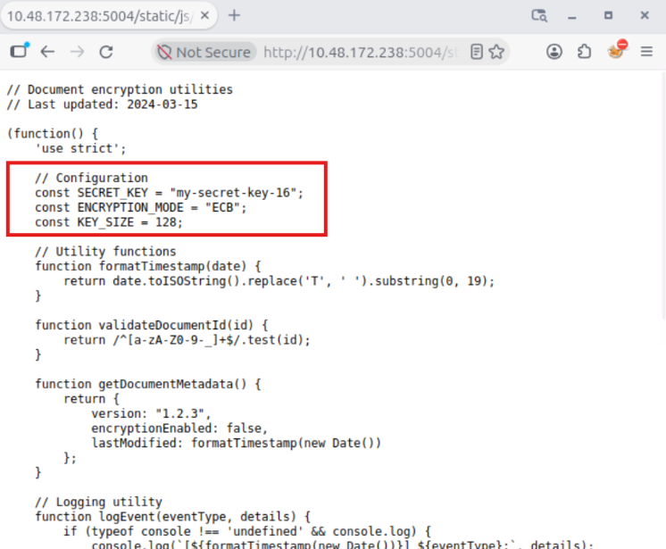
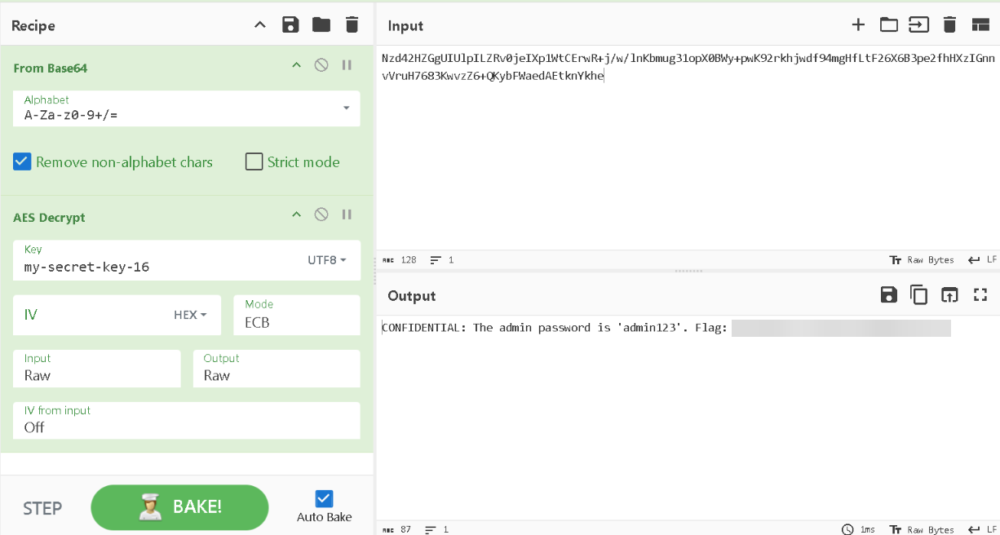
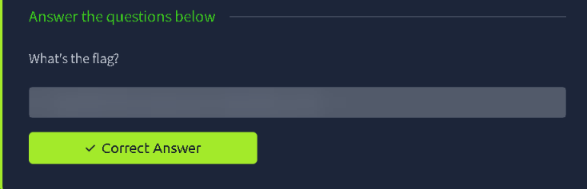
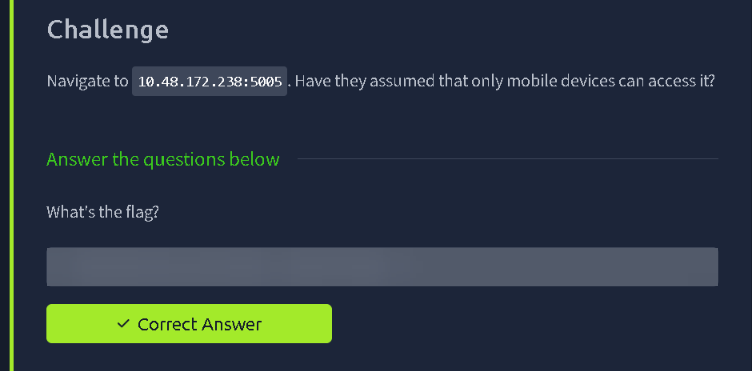

# OWASP Top 10 2025: Application Design Flaws — TryHackMe Writeup



| | |
|---|---|
| **Platform** | TryHackMe |
| **Path** | Cyber Security 101 → OWASP Top 10 (2025) |
| **Room** | OWASP Top 10 2025: Application Design Flaws |
| **Time** | ~30 min |
| **Author** | [Shaurya Rathore](https://github.com/shauryarathore357-hub) |
| **Status** | Completed ✅ |

> **Spoiler policy:** all flag values are blurred (the answer boxes, and every place a flag appeared in a response). The URLs, keys, recipes and reasoning are left visible so you can follow the technique and get the flags yourself.

---

## Overview

The room covers four categories from the **OWASP Top 10 (2025)**: **A02, A03, A06 and A10**. It looks at how they show up as *design* problems in an application, meaning mistakes that exist because of how the app was built rather than because of a single typo in the code.

Each category has a small vulnerable web app on the target machine (each on its own port) and one flag to capture:

| # | Challenge | Theme | Port |
|---|---|---|---|
| 1 | Too many traces in the User Management API | Verbose errors / improper error handling (A10) | `5002` |
| 2 | A vulnerable component in the supply chain | Software supply chain failure (A03) | — |
| 3 | A key shipped inside the app | Cryptographic failure: hard-coded key | `5004` |
| 4 | "Only mobile devices can access it" | Insecure design assumption (A06) | `5005` |

**Skills practised**

- Triggering and reading verbose error responses
- Finding secrets leaked in client-side JavaScript
- Decrypting AES data in CyberChef once the key is known
- Recognising trust placed in client-controlled information

> **Setup:** start the room's machine; the target in my session was `10.48.172.238` (IPs are assigned per session, so yours will differ). Everything below was done from the browser, plus CyberChef.

---

## 1. Recon & Key Finding: Verbose Error Leak (port 5002)

**Challenge prompt:** *"Navigate to `10.48.172.238:5002`. It appears that the developers left too many traces in their User Management APIs."*

The hint points at **debug output**. The User Management API exposes users by ID, so the thing to try is requesting a user with an ID the server doesn't expect. Instead of a number, I passed text:

```text
http://10.48.172.238:5002/api/user/abc
```

(The same request with `curl http://10.48.172.238:5002/api/user/abc` should return the same JSON.)

The server didn't return a tidy "bad request". It returned a raw **`debug_info`** object, which Firefox's JSON viewer lays out for us:

| Field | What leaked |
|---|---|
| `flag` | The flag itself, sitting in the response *(blurred)* |
| `error` | `Invalid user ID format: abc. Flag: …` |
| `traceback` | A full Python stack trace |



The traceback is a goldmine beyond the flag. It reveals:

- the application path and framework language: `"/app/app.py"`, **Python**
- the exact line and function that failed: **line 21, in `get_user`**
- the **source code** of the failing statement:
  `raise ValueError(f"Invalid user ID format: {user_id}. Flag: {FLAG}")`

That last line shows the root cause: the developer put the secret *inside the exception message*, and the application returns exceptions straight to the client.

**Flag:** `THM{██████████}`

> 💡 **Why it matters:** error pages are reconnaissance. File paths, library versions, internal variable names and code snippets let an attacker map the application. This is what the 2025 list groups under *Mishandling of Exceptional Conditions* (A10).

**Fix:** catch exceptions and return a generic message (`400 Invalid request`), log the detail **server-side only**, turn debug mode off in production, and never put secrets in strings that can end up in an error.

---

## 2. Software Supply Chain Vulnerability (A03)

The second challenge is about a **vulnerable component in the application's supply chain**, i.e. code the app depends on but didn't write.



**Flag:** `THM{██████████}`

<!-- OPTIONAL: add your own screenshots/commands showing how you found the vulnerable component here -->

> 💡 **How this class of flaw is approached:** identify the third-party components and versions an app relies on (libraries, packages, scripts, base images), then compare them with known advisories. An application is only as safe as its weakest dependency, and updating a dependency is an application-wide decision.

**Fix:** keep an inventory (SBOM) of dependencies, pin and verify versions, scan them continuously, and only pull from trusted sources.

---

## 3. Cryptographic Failure: A Hard-Coded Key (port 5004)

### 3.1 Finding the key

The application on port `5004` serves its encryption logic to the browser as a static JavaScript file under `/static/js/`. Opening it directly (a header comment says *"Document encryption utilities, last updated 2024-03-15"*) shows the configuration at the top of the file:

```javascript
// Configuration
const SECRET_KEY = "my-secret-key-16";
const ENCRYPTION_MODE = "ECB";
const KEY_SIZE = 128;
```



Three problems in three lines:

| Line | Problem |
|---|---|
| `SECRET_KEY = "my-secret-key-16"` | The **secret key is shipped to every visitor**. Anyone who can load the page can read it. |
| `ENCRYPTION_MODE = "ECB"` | **ECB** encrypts identical blocks identically and uses no IV, so patterns leak. It is not recommended for anything but the most trivial cases. |
| `KEY_SIZE = 128` | A 16-character key (`my-secret-key-16` is exactly 16 bytes) means AES-128. Fine in itself, but meaningless once the key is public. |

### 3.2 Decrypting the data in CyberChef

With the algorithm, mode and key all known, decrypting the application's encrypted data is a two-step recipe in CyberChef:

| Step | Operation | Settings |
|---|---|---|
| 1 | **From Base64** | Alphabet `A-Za-z0-9+/=`, *Remove non-alphabet chars* ticked |
| 2 | **AES Decrypt** | Key `my-secret-key-16` (**UTF8**), IV left empty, Mode **ECB**, Input **Raw**, Output **Raw** |

Pasting the Base64 ciphertext into **Input** and baking gives readable plaintext in **Output**:

```text
CONFIDENTIAL: The admin password is 'admin123'. Flag: THM{…}
```



The decrypted text exposes an **admin password** (a weak one, too) alongside the flag. That's the real-world impact: the "encryption" protected nothing.



**Flag:** `THM{██████████}`

> 💡 **Tip for the recipe:** the Key field has a dropdown (UTF8 / Hex / Latin1 / Base64). A text key like `my-secret-key-16` must be set to **UTF8**, or CyberChef will interpret the characters differently and the decryption will fail.

**Fix:** never put keys in client-side code or source control. Keep them in a secrets manager on the server, use an authenticated mode such as **AES-GCM** with a unique IV per message, and don't store plaintext passwords at all.

---

## 4. Insecure Design: The "Mobile Only" Assumption (port 5005)

**Challenge prompt:** *"Navigate to `10.48.172.238:5005`. Have they assumed that only mobile devices can access it?"*



The question is the vulnerability. The designers decided the app is safe because "only mobile devices will ever reach it", and enforce that by trusting what the **client says about itself**. Anything the client sends, such as the `User-Agent` header, is under the attacker's control. To test the assumption, change what the client claims to be, for example with a mobile `User-Agent`:

```bash
curl -A "<mobile user-agent string>" http://10.48.172.238:5005
```

<!-- OPTIONAL: add your own screenshot of the request/response that returned the flag here -->

**Flag:** `THM{██████████}`

> 💡 **Why it matters:** this is a *design* flaw, not a coding bug. No amount of clean code fixes a security control that depends on an assumption about who the user is. In the 2025 list this sits under **Insecure Design** (A06).

**Fix:** enforce access control with real authentication and authorisation on the server. Treat device type, headers and network location as hints, never as security boundaries, and threat-model features before building them.

---

## Key Takeaways

1. **Error handling is a security feature.** Verbose errors turn every bug into a recon tool; return generic messages, log details privately.
2. **Anything shipped to the browser is public.** Keys, tokens and config in JavaScript are not secrets.
3. **Encryption is only as strong as its key management and mode.** A hard-coded key plus ECB is effectively no encryption.
4. **Never trust client-controlled data for security decisions.** Headers like `User-Agent` can be set to anything.
5. **Design flaws can't be patched away.** They need threat modelling up front, because the problem is the assumption, not a single line of code.
6. **You inherit your dependencies' bugs.** Track what you ship and keep it updated.

## Tools Used

- Firefox (JSON viewer, viewing static JS)
- [CyberChef](https://gchq.github.io/CyberChef/): From Base64, AES Decrypt
- `curl` (equivalent requests)

## What's Next

On to the next room in the **OWASP Top 10 (2025)** module. Follow along on [TryHackMe](https://tryhackme.com/p/shauryarathore357) and [GitHub](https://github.com/shauryarathore357-hub).

---

*Writeup by Shaurya Rathore. Flags intentionally redacted. Do the room yourself, it's worth the 30 minutes.*
